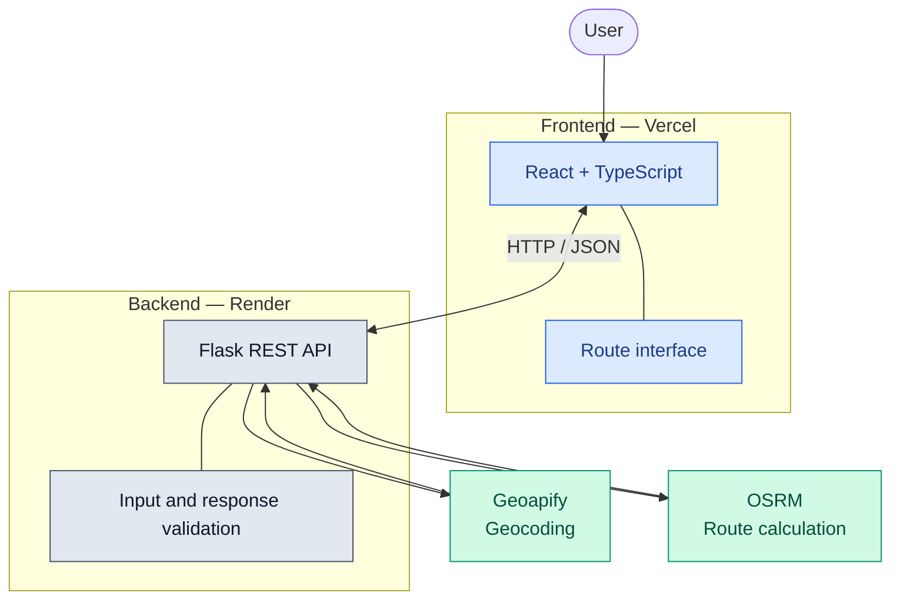

# RouteWise

<p align="center">
  <strong>A smarter way to plan your journey.</strong>
  <br />
  A full-stack route-planning application built with React, TypeScript and Flask.
</p>

<p align="center">
  <a href="https://route-wise-ochre.vercel.app/">
    
  </a>
  <a href="https://github.com/asmaghanmi1/RouteWise/actions">
    
  </a>
</p>

<p align="center">
  
  
  
  
  
  
</p>

---

## Overview

**RouteWise** is a full-stack web application designed to calculate driving routes between two locations. It combines a responsive frontend, a REST API, geocoding, and route calculation services in a separately deployed architecture.

The project demonstrates practical skills in frontend development, backend API design, external service integration, input validation, automated testing, and continuous integration.

|                      |                                                                     |
| -------------------- | ------------------------------------------------------------------- |
| **Live application** | [route-wise-ochre.vercel.app](https://route-wise-ochre.vercel.app/) |
| **Backend API**      | [routewise-mbyc.onrender.com](https://routewise-mbyc.onrender.com/) |
| **Repository**       | [GitHub — RouteWise](https://github.com/asmaghanmi1/RouteWise)      |
| **CI workflow**      | [GitHub Actions](https://github.com/asmaghanmi1/RouteWise/actions)  |

## Features

* **Driving route calculation** — request a route between an origin and a destination.
* **Location geocoding** — convert place names into geographic coordinates through Geoapify.
* **External routing integration** — retrieve road-route information from OSRM.
* **REST API** — communicate through structured HTTP and JSON requests.
* **Input validation** — reject malformed requests, invalid location values, and overly long place names.
* **Routing response validation** — check external routing data before using it.
* **Health endpoint** — check whether the backend API is responding.
* **Automated quality checks** — execute backend tests, frontend linting, and a production build through GitHub Actions.

## Architecture



### Request lifecycle

1. The user enters an origin and a destination.
2. The frontend submits the location data to the Flask API.
3. The backend validates the request.
4. Geoapify resolves the place names into coordinates.
5. OSRM calculates the driving route.
6. The backend validates the routing response and returns the result to the frontend.

The frontend and backend are hosted independently. External geocoding and routing services provide the geographic data and route calculations.

## Technology Stack

| Layer            | Technologies                   |
| ---------------- | ------------------------------ |
| Frontend         | React, TypeScript, Vite        |
| Backend          | Python, Flask                  |
| API              | REST, HTTP, JSON               |
| Geocoding        | Geoapify                       |
| Routing          | OSRM                           |
| Backend tests    | pytest                         |
| Frontend checks  | ESLint, TypeScript, Vite build |
| CI               | GitHub Actions                 |
| Frontend hosting | Vercel                         |
| Backend hosting  | Render                         |
| Version control  | Git, GitHub                    |

## Project Structure

```text
RouteWise/
├── .github/
│   └── workflows/
│       └── ci.yml
├── backend/
│   ├── tests/
│   │   └── test_app.py
│   ├── app.py
│   ├── requirements.txt
│   └── requirements-dev.txt
├── frontend/
│   ├── public/
│   ├── src/
│   ├── package.json
│   ├── package-lock.json
│   └── vite.config.ts
├── .gitignore
└── README.md
```

## Getting Started

### Prerequisites

Install the following tools:

* Python 3.12
* Node.js 22 and npm
* Git
* A Geoapify API key for geocoding

The application also depends on the availability of the configured OSRM routing service.

### 1. Clone the repository

```bash
git clone https://github.com/asmaghanmi1/RouteWise.git
cd RouteWise
```

### 2. Set up the backend

From the repository root, run:

```powershell
cd backend
python -m venv .venv
.\.venv\Scripts\Activate.ps1
python -m pip install -r requirements.txt
```

Configure the API key in the current PowerShell session:

```powershell
$env:GEOAPIFY_API_KEY = "YOUR_GEOAPIFY_API_KEY"
```

Replace the placeholder with your own key. Do not commit the key to Git.

Start the backend:

```powershell
python app.py
```

The default local API address is expected to be `http://127.0.0.1:5000`, provided the application uses the default Flask development server configuration.

### 3. Set up the frontend

Open a second terminal and navigate to the frontend directory:

```powershell
cd frontend
npm ci
npm run dev
```

Open the local URL displayed by Vite.

For local development, ensure the frontend API configuration points to the local Flask backend. The deployed frontend uses the Render API.

## API Reference

### Health check

`GET /api/health`

Checks whether the backend is responding.

```http
GET /api/health
```

Example response:

```json
{
  "service": "RouteWise API",
  "status": "ok"
}
```

### Calculate a route

`POST /api/route`

Example request:

```json
{
  "origin": "Tunis, Tunisia",
  "destination": "Sousse, Tunisia"
}
```

The backend validates the submitted locations, requests geocoding from Geoapify, and uses OSRM to calculate the driving route.

| HTTP status | Meaning                                     |
| ----------- | ------------------------------------------- |
| `200`       | Successful request                          |
| `400`       | Invalid request or input                    |
| `404`       | Location not found                          |
| `502`       | External service or response error          |
| `503`       | Service configuration or availability issue |

The precise response fields depend on the backend implementation and the outcome of the request.

## Testing and Continuous Integration

RouteWise includes backend tests for the health endpoint, malformed requests, input validation, and routing response validation.

### Run backend tests

From the repository root:

```powershell
python -m pip install -r backend/requirements-dev.txt
python -m pytest backend/tests -v
```

### Run frontend linting

```powershell
npm --prefix .\frontend run lint
```

### Build the frontend

```powershell
npm --prefix .\frontend run build
```

### GitHub Actions pipeline

The workflow in `.github/workflows/ci.yml` runs on pushes to `master` and pull requests targeting `master`.

It performs two jobs:

**Backend tests**

* Install Python dependencies.
* Run the pytest suite.

**Frontend checks**

* Install dependencies using `npm ci`.
* Run ESLint.
* Build the production frontend.

The workflow has completed successfully for the project. Future executions can be checked on the [GitHub Actions page](https://github.com/asmaghanmi1/RouteWise/actions).

## Deployment

| Component   | Platform | URL                                                         |
| ----------- | -------- | ----------------------------------------------------------- |
| Frontend    | Vercel   | [Open application](https://route-wise-ochre.vercel.app/)    |
| Backend     | Render   | [Open API](https://routewise-mbyc.onrender.com/)            |
| Source code | GitHub   | [View repository](https://github.com/asmaghanmi1/RouteWise) |

### Production configuration

The backend requires the `GEOAPIFY_API_KEY` environment variable for geocoding requests. Configure it in the Render service environment settings.

CORS must allow the deployed frontend origin.

GitHub Actions provides continuous integration. Automatic production deployment after a push depends on the deployment settings configured in Vercel and Render.

## Security and Limitations

* API credentials must remain in backend environment variables.
* Route calculation depends on third-party geocoding and routing services.
* Public routing services can impose usage limits or experience downtime.
* The health endpoint checks API responsiveness but does not guarantee that all external dependencies are operational.
* The GitHub Actions pipeline validates tests, linting, and frontend compilation; it is not, by itself, an end-to-end test of the deployed application.

## Roadmap

Potential improvements include:

* Add integration tests with mocked external API responses.
* Add automated frontend tests.
* Improve logging and external-service error reporting.
* Add end-to-end tests against a controlled test environment.
* Improve monitoring and API documentation.
* Evaluate caching and request management to improve resilience.

## Author

**Asma Ghanmi**

Full-stack application project focused on web development, REST APIs, external service integration, testing, deployment, and continuous integration.

---

<p align="center">
  <sub>Built with React, Flask, Geoapify, OSRM and GitHub Actions.</sub>
</p>
